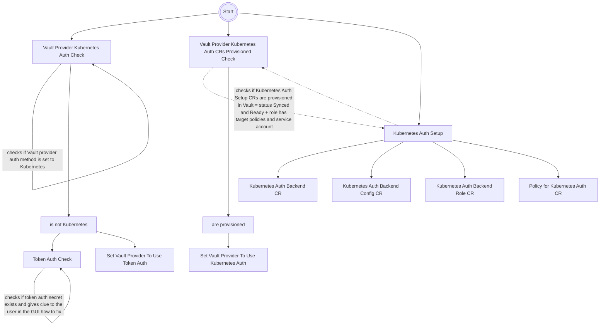
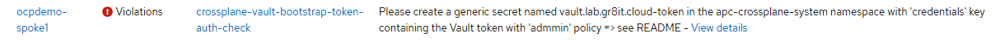

# Crossplane Vault Provider bootstrap



> [!NOTE]  
> The Crossplane Vault Provider bootstrap is not automatic, as it requires manual creation of an Vault token

> [!WARNING]  
> The Token secret must be created on the MANAGED CLUSTER, not on hub cluster!

> [!WARNING]  
> As the chart is implemented as an ACM policy, meaning the component has to be installed on the hub cluster only!

> [!IMPORTANT]  
> Requires provider-vault >= v4.0.0 (`crossplane-vault-provider` chart >= 1.6.0), whose ProviderConfig CRD supports `spec.mountPath`.
> Roll out the provider upgrade first and wait for the Provider to be Healthy before deploying this chart >= 2.1.0.

The chart is implemented as an ACM policy and does following:

- Checks if Vault ProviderConfig is using Kubernetes auth method
  - If yes => the target status
  - If not
    - Sets Vault Provider to use Token auth for bootstrap (only until the Kubernetes Auth CRs are provisioned)
    - Starts a helper policy to inform user in the GUI where to create the Token secret
- Starts Kubernetes Auth Setup
  - Waits for the Token secret to be created - see [Token Secret generation](#token-secret-generation)
  - Provisions the Vault CRs (Auth Backend, AuthBackendConfig, AuthBackendRole, Policy) required for Kubernetes Auth
- Checks if Kubernetes Auth CRs provisioned
  - All CRs created in the Kubernetes Auth Setup must by in Sync & Ready status
  - The AuthBackendRole in Vault (`status.atProvider`) must already contain the target token policies and bound service account
  - If Kube Auth CRs are provisioned
    - Sets Vault Provider to use Kubernetes auth

> [!IMPORTANT]  
> The Token secret is NOT removed automatically. After the switch, verify all Vault managed resources are `Synced` (`kubectl get managed`), then remove the secret and revoke the token manually:
>
> ```bash
> kubectl -n apc-crossplane-system get secret <vault-name>-token -o jsonpath='{.data.credentials}' | base64 -d | jq -r .token  # token to revoke
> vault token revoke <token>
> kubectl -n apc-crossplane-system delete secret <vault-name>-token
> ```

## Token Secret generation

1) Admin creates a token using `vault token create -ttl=15m --renewable=false`

   ```bash
   Key                  Value
   ---                  -----
   token                hvs.CAESFrBiuq2OJ4J1Vcr6-tiEyY0kZVeDQzTXh9fpiBVt1BBmnxEFWGh4KHGh2cy42R2IGmpsTXBOZ0xJYkZuQ25kemg
   token_accessor       wpVWsKklJhRTIEE374JbeyF7
   token_duration       15m
   token_renewable      false
   token_policies       ["admin" "default"]
   identity_policies    []
   policies             ["admin" "default"]
   ```

> [!NOTE]  
> Policies of the creating (admin) user will be reused by default. Or specify policy to be used using `-policy <policy-name>`

1) Copy the token from the `token` parameter

1) Store the token to a file:

   ```bash
   cat <<EOF > /tmp/vault-credentials
   {
     "token_name": "admin",
     "token": "<token>"
   }
   EOF
   ```

1) Create the Token secret on MANAGED CLUSTER(s)

   ```bash
   kubectl create secret generic <secret-name> -n apc-crossplane-system --from-file=credentials=/tmp/vault-credentials
   rm -f /tmp/vault-credentials
   ```

   Where secret-name is generated from the Vault name global service parameter suffixed with `-token`, e.g.:

> [!NOTE]  
> The Token secret to be used hint is available in the ACM GUI -> Governance -> Policies -> crossplane-vault-provider-bootstrap -> Results -> *-providerconfig-token-auth policy Message:
>
> 

### Helm Chart Parameters

|Parameter|Default|Description|
|---|---|---|
|cluster.name|`.global.apc.cluster.name`|Cluster name to be used instead of local-cluster|
|caCertificates|`.global.apc.caCertificates`|PEM encoded CA cert to trust when Vault makes contact to the Kube API|
|services.vault.url|`.global.apc.services.vault.url`|Vault URL|
|services.vault.name|`.global.apc.services.vault.name`|Vault Name|
|services.crossplane.kubeVaultProviderConfigName|`.global.apc.services.crossplane.kubeVaultProviderConfigName`|Name of the Vault provider config to create|
|vaultKubeAuthMountPath|-|For testing only as it only support 1 cluster only !!! normally filled in by hub ACM templating => Kube auth mount path in Vault|
|vaultKubernetesRole|crossplane|Kubernetes role in Vault for Crossplane to use|
|vaultKubernetesRoleExtraPolicies|`[]`|Additional Vault policies assigned to the Kubernetes role, e.g. `[admin]` until the role policy covers all paths managed by the provider|
|vaultProviderServiceAccount|crossplane-vault-provider|Service account of the Crossplane Vault provider allowed to log in with the Kubernetes role (requires `crossplane-vault-provider` chart >= 1.6.0)|
|crossplaneNamespace|apc-crossplane-system|Namespace where Crossplane is installed, and configurations are created|

## Removal

- remove the policy.policy.open-cluster-management.io
- remove the kube auth from Vault

### Bootstrap

- to run the bootstrap process again, set the particular Provider Config credentials source to `Secret`, e.g.

```bash
kubectl patch providerconfig vault.lab.gr8it.cloud --type="merge" -p '{"spec": {"credentials":{"source": "Secret"}}}'
```

## TODO

- Monitoring Governance pravidiel!? Ak su non-compliant, mal by prist alarm ..
